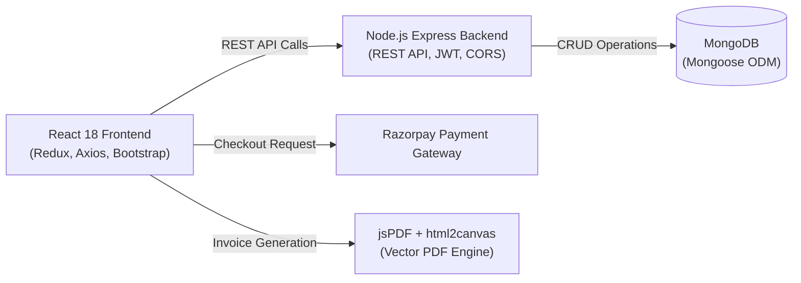

<!-- Vercel Deployment Trigger: 2026-11-27 -->
<div align="center">

# 🚌 BlueBus — Web-Based Bus Ticket Booking System
### Full-Stack MERN Online Bus Reservation Platform with Smart Seat Layouts, AI Travel Assistant & Instant E-Ticket PDF Downloads

[](https://web-based-ticket-booking-system-mz4.vercel.app)
[](https://react.dev/)
[](https://redux.js.org/)
[](https://nodejs.org/)
[](https://expressjs.com/)
[](https://www.mongodb.com/)
[](https://razorpay.com/)
[](#license)

[🚀 Live Demo](https://web-based-ticket-booking-system-mz4.vercel.app) • [🌟 Live Features](#-key-features) • [🛠️ Tech Stack](#-technology-stack) • [⚡ Quick Start](#-quick-start-local) • [📡 API Reference](#-rest-api-endpoints)

</div>

---

## 📌 Project Overview

**BlueBus** is an enterprise-grade, full-stack online bus reservation system inspired by industry leaders like **RedBus** and **MakeMyTrip**. Built with the **MERN Stack** (MongoDB, Express, React, Node.js), it provides end-to-end ticketing with live sleeper and seater coach visualization, gender-aware berth safety protection, simultaneous multi-passenger reservations, real-time departure/arrival time filters across 45+ Indian cities, instant PDF ticket generation, and a 24/7 conversational AI travel assistant (**BlueBot AI**).

---

## 🌟 Key Features

### 1. 💺 Authentic Indian Bus Coach Layouts
* **2+1 Sleeper Coaches (30 Berths):**
  - **Lower Deck (L1 – L15)** & **Upper Deck (U1 – U15)** with driver cabin orientation and gangway aisle.
  - Realistic single window berths, aisle berths, and double sleeper berths.
* **2+2 Pushback Seater Coaches (Seats 1 – 40):**
  - Traditional 10-row seating with window and aisle seat separation.

### 2. 🛡️ Gender-Segregated Berth Protection
* 🌸 **Ladies Berths (Pink):** Booked by female travelers; strictly protected to ensure safety.
* 🔵 **Male Berths (Slate-Blue):** Booked by male passengers.
* ⚪ **Available Berths (White):** Open for reservation.
* 🟢 **Selected Berths (Green):** In-progress selections.
* **Double-Booking Shield:** Atomic server-side validation returns `HTTP 409 Conflict` if another traveler books the seat concurrently.

### 3. 👥 Multi-Ticket Booking Engine
* Reserve **multiple seats simultaneously** in a single checkout.
* Dynamic individual passenger cards capture **Name**, **Age**, and **Gender** for each seat.
* **⚡ Quick-Fill Group:** Single-click helper for group and family bookings.

### 4. ⏰ Real-Time Departure & Arrival Filters
* Dynamic time windows:
  - 🌙 **Before 6:00 AM**
  - 🌅 **6:00 AM to 12:00 PM**
  - ☀️ **12:00 PM to 6:00 PM**
  - 🌃 **After 6:00 PM**
* Live bus count indicators `(N)` next to each checkbox that update instantly as filters are applied.
* **"Apply Filter"** button with responsive toast feedback notifications.

### 5. 📥 E-Ticket PDF Downloads & Print
* Direct client-side PDF generation powered by `html2canvas` and `jsPDF`.
* Downloads high-resolution `Bus_Ticket_${pnr}.pdf` alongside native print capabilities.
* Displays verified PNR, QR code verification, boarding/dropping landmarks, and full passenger manifest.

### 6. 🤖 BlueBot AI Conversational Assistant
* Real-time conversational widget with thinking state toggle.
* **Instant PNR Status Checker:** Verifies any PNR (e.g. `PNR-PJ-77059`) with live journey details.
* **Smart Route Recommendations:** Evaluates fastest vs lowest-fare buses.

### 7. 📍 45 Indian Cities & Landmark Stops
* Comprehensive coverage across Maharashtra, Gujarat, Karnataka, Delhi-NCR, Rajasthan, Goa, and more.
* Authentic boarding points (e.g., *Nigdi Nishant Travels, Swargate, Viman Nagar*) and dropping points (*Jalgaon Old B.S, Akashwani Chowk*).

---

## 🛠️ Technology Stack



### Frontend (Client)
- **Framework:** React.js 18.2.0 (SPA)
- **State Management:** Redux 4.2.1, Redux Thunk, React-Redux
- **Routing:** React Router DOM v6.8.2 (Protected Routes)
- **Styling:** CSS Modules, Bootstrap 5.2.3, React Icons
- **PDF Generation:** `jsPDF` (v4.2) + `html2canvas` (v1.4)
- **Notifications:** `react-toastify`

### Backend (Server)
- **Runtime:** Node.js (v18+)
- **Server Framework:** Express.js 4.21.2
- **Database & ODM:** MongoDB, Mongoose 7.0.0
- **Authentication:** JSONWebToken (JWT 9.0.2)
- **Payment Processing:** Razorpay Node SDK 2.8.6
- **Date Utilities:** Moment.js 2.29.4
- **Environment:** `dotenv`, `cors`

---

## ⚡ Quick Start (Local Setup)

### Option 1: One-Click Launch (Windows)
Double-click **`start_project.bat`** in the root directory. It automatically starts MongoDB, the backend server (`:8080`), the frontend client (`:3000`), and opens your default browser!

### Option 2: Manual Terminal Setup

#### 1. Clone the Repository
```bash
git clone https://github.com/Chetanpatil1666/Web-Based-Ticket-Booking-System.git
cd Web-Based-Ticket-Booking-System
```

#### 2. Start the Backend API
```bash
cd code/server
npm install
npm start
```
*Backend runs at `http://localhost:8080`*

#### 3. Start the React Frontend
```bash
cd ../client
npm install
npm start
```
*Frontend opens at `http://localhost:3000`*

---

## 🚀 Production Deployment

A complete production deployment guide is available in [`DEPLOYMENT_GUIDE.md`](./DEPLOYMENT_GUIDE.md).

| Component | Recommended Host | Build Command | Output / Start |
| :--- | :--- | :--- | :--- |
| **Backend API** | [Render](https://render.com) / [Railway](https://railway.app) | `npm install` | `npm start` (reads `PORT`) |
| **Database** | [MongoDB Atlas](https://www.mongodb.com/cloud/atlas) | Free M0 Cluster | Set in `MONGO_PATH` |
| **Frontend Web App** | [Vercel](https://vercel.com) / [Netlify](https://netlify.com) | `npm run build` | `build/` (reads `REACT_APP_API_URL`) |

### Environment Variables

#### Backend (`code/server/.env`)
```env
PORT=8080
MONGO_PATH=mongodb+srv://<user>:<password>@cluster0.mongodb.net/newbus?retryWrites=true&w=majority
JWT_SECRET=your_super_secret_jwt_key
RAZORPAY_KEY_ID=rzp_test_xxxxxxxxxx
RAZORPAY_KEY_SECRET=xxxxxxxxxxxxxxxx
NODEMAILERUSER=your_email@gmail.com
NODEMAILERPASSWORD=your_app_password
```

#### Frontend (`code/client/.env`)
```env
REACT_APP_API_URL=https://your-backend-api.onrender.com
```

---

## 📡 REST API Endpoints

| Method | Endpoint | Description | Auth Required |
| :--- | :--- | :--- | :---: |
| `GET` | `/health` | Server uptime & database health check | No |
| `POST` | `/user/signup` | Register a new passenger account | No |
| `POST` | `/user/login` | Authenticate user & receive JWT token | No |
| `GET` | `/city` | Get all 45 Indian cities & landmark stops | No |
| `POST` | `/bus/getall` | Search available buses by route & date | No |
| `GET` | `/bus/:id` | Get details and seat map of a specific bus | No |
| `POST` | `/order/create` | Atomically reserve multiple seats & generate PNR | Yes |
| `GET` | `/order/myorders` | Retrieve user booking history | Yes |
| `DELETE` | `/order/cancel/:id` | Cancel booking & release seats to pool | Yes |
| `POST` | `/ai/query` | Conversational BlueBot AI query resolution | No |
| `POST` | `/api/payment/orders` | Create Razorpay order transaction | Yes |

---

## 📂 Project Directory Structure

```text
Web-Based-Ticket-Booking-System/
├── DEPLOYMENT_GUIDE.md       # Step-by-step production deployment instructions
├── PROJECT_DETAILS.md        # Technical architecture, schemas & workflows
├── COMMANDS.md               # PowerShell scripts & cURL test queries
├── README.md                 # Project overview & documentation
├── start_project.bat         # 1-click Windows launcher (starts both services)
├── start_server.bat          # 1-click backend launcher
├── start_client.bat          # 1-click frontend launcher
│
├── code/
│   ├── client/               # React 18 SPA Frontend
│   │   ├── public/           # Favicon, manifest, _redirects for Netlify
│   │   ├── src/
│   │   │   ├── Components/   # Seats layout, Ticket PDF, AI chatbot, Landing
│   │   │   ├── Pages/        # Home, SelectBus, Details, MyTicket, Signin
│   │   │   ├── Redux/        # Auth, Filter, Ticket state stores
│   │   │   ├── Utils/        # Time parser, city stops, notification toasts
│   │   │   └── config/       # Centralized API_BASE_URL configuration
│   │   ├── vercel.json       # SPA rewrite rules for Vercel
│   │   └── package.json
│   │
│   └── server/               # Express.js & MongoDB Backend
│       ├── src/
│       │   ├── configs/      # Mongoose DB connection logic
│       │   ├── controllers/  # Bus, City, Order, Payment, AI controllers
│       │   └── models/       # Mongoose schemas (Bus, City, Order, User)
│       ├── cities.json       # 45 Indian cities with boarding/dropping points
│       ├── busses.json       # Fleet templates
│       ├── seed.js           # Database seed script
│       ├── Procfile          # Heroku/Render process declaration
│       └── package.json
```

---

## 👥 Demo Credentials
For testing in development or demonstration mode:
- **Email:** `demo@gmail.com`
- **Password:** `password123`

---

## 📄 License
This project is licensed under the [MIT License](LICENSE).
